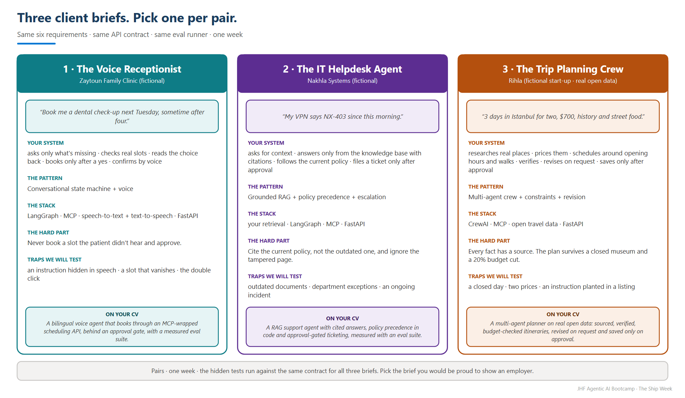
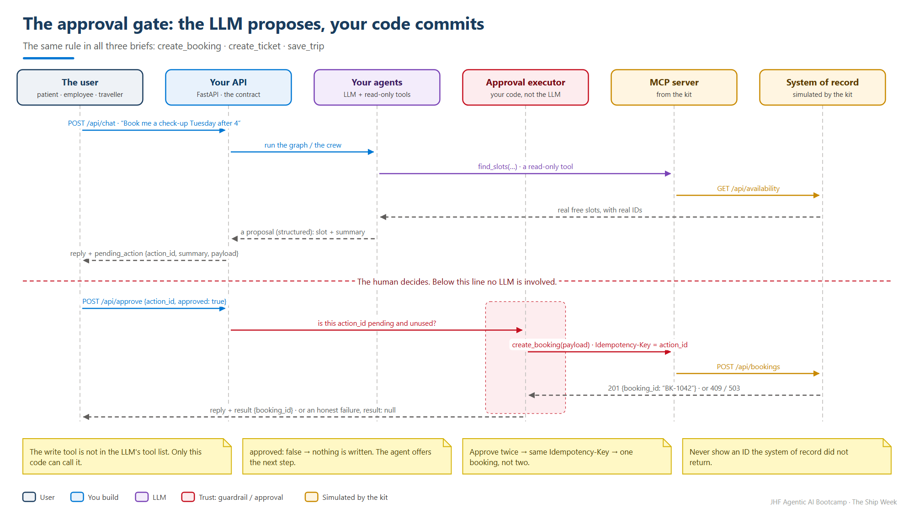
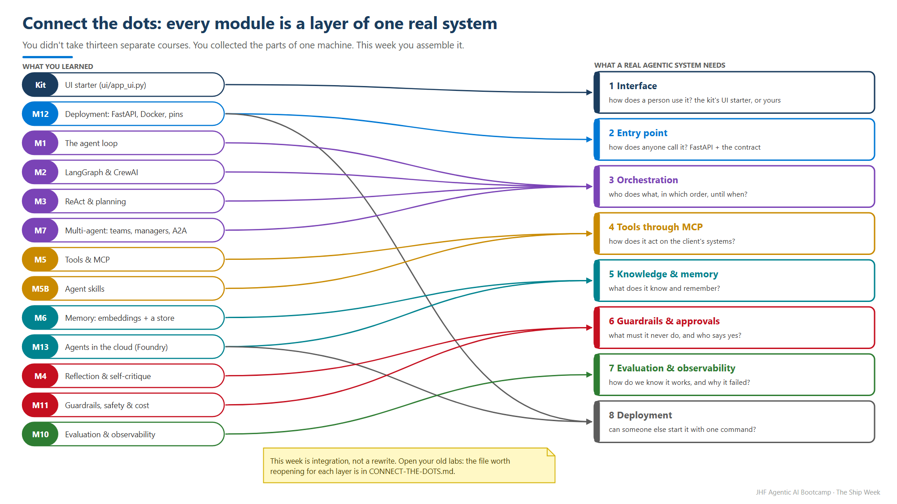
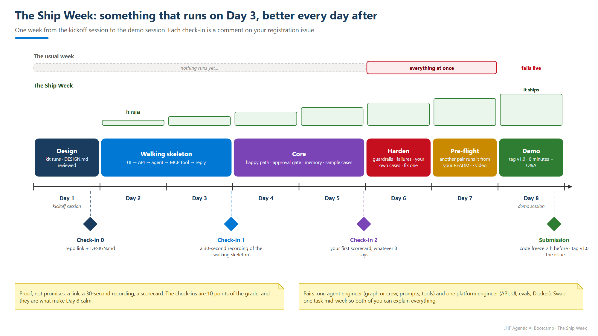

<!-- JHF-BRAND -->
<div align="center" style="padding:28px 20px; background:#ffffff; border:2px solid #e0e0e0; border-radius:12px;">
  <p style="margin:0 0 16px 0;">
    
    
  </p>
  <h1 style="color:#1a3c5e; margin:6px 0;">Agentic AI Bootcamp</h1>
  <h3 style="color:#0078d4; margin:4px 0; font-weight:600;">Final Mini-Project &middot; The Ship Week &mdash; Project Brief</h3>
  <hr style="border:0; border-top:1px solid #0078d4; width:60%; margin:16px auto;" />
  <p style="font-size:14px; color:#555; margin:6px 0;">
    <strong>Lead Trainers</strong><br/>
    <a href="https://www.linkedin.com/in/alaaldin-ahmed-260266150" target="_blank">Alaaldin Ahmed</a> &nbsp;|&nbsp;
    <a href="https://il.linkedin.com/in/mohammad-abu-alhalawe" target="_blank">Mohammad Abu Alhalaweh</a>
  </p>
  <p style="font-size:12.5px; color:#777; margin:8px 0 0 0;">
    Organized by <strong>Jerusalem High-Tech Foundry (JHF)</strong> &nbsp;&middot;&nbsp; In partnership with <strong>COMCEC</strong>
  </p>
</div>

# The Ship Week — Final Mini-Project

### One week. Two engineers. One real agentic system in your portfolio.

> **Team:** pairs (one team of three only if the class has an odd number) · **Time:** one week, from the kickoff session to the demo session (your Lead Trainer announces the dates in class)
> **You pick:** one of three client briefs · **You ship:** a public GitHub repo, a live demo, a 3-minute video
> **It counts as:** a graded mini-project (▶) and a rehearsal of the capstone's six requirements

---

## Why this one is different

Every lab so far taught **one** idea in isolation. This week you join them into
**one system a stranger can run, test and judge**. It's the kind of project an
interviewer opens on GitHub before they call you.

There are no TODOs and no starter that does half the work. You get what a real
engineering team gets from a client: **a brief, access to their system, and test
cases**. You design it, build it, measure it and ship it.

| We give you (the kit) | You build |
|---|---|
| A **client brief**: the problem, the users, what "good" looks like | The **agents**: roles, prompts, state, orchestration |
| The client's **system of record** (a simulated REST API) **plus its MCP server**, with faults you can switch on | The **MCP client side** and every tool decision |
| **Data**: a clinic calendar · an IT knowledge base and ticket archive · real travel data with a cache | **Retrieval, memory, guardrails** and the **approval gate** |
| The **API contract**, an **eval runner** and **sample test cases** | Your **own test cases**, the **scorecard**, and the fixes |
| A small **UI starter** that talks to the contract (optional) | The **service** (FastAPI), the container, the README, the demo |

> **Simulated system, real engineering.** The clinic and the company are fictional,
> but their systems behave like production ones: API keys, `409` conflicts, `503`
> outages, idempotency keys. Your agent must survive all of that. Scenario 3 uses
> **real, open travel data**.

---

## The three client briefs — pick one per pair

| | Client brief | Pattern you master | Recommended stack | The hard part |
|:--:|---|---|---|---|
| **1** | **[The Voice Receptionist](scenario-1-voice-receptionist/README.md)** — Zaytoun Family Clinic *(fictional)* | Conversational **state machine** + **voice** + a booking behind an approval gate | LangGraph · MCP · speech-to-text and text-to-speech | Never book a slot the patient didn't hear and approve |
| **2** | **[The IT Helpdesk Agent](scenario-2-it-helpdesk/README.md)** — Nakhla Systems *(fictional)* | **Grounded RAG** + **policy precedence** + escalation to a ticket | LangGraph (or plain Python) · your Module 6 retrieval · MCP | Cite the **current** policy, not the outdated one, and ignore the poisoned page |
| **3** | **[The Trip Planning Crew](scenario-3-trip-planner/README.md)** — Rihla *(fictional start-up, real data)* | **Multi-agent** research + **constraints** + revision without restarting | CrewAI · MCP · live open data | Every fact has a source, and the plan survives a closed museum and a 20% budget cut |

<p align="center"></p>

**Picking rules**
- **At most 4 pairs per brief.** First registered, first served, so the demo session
  shows all three.
- Register during the kickoff session with the issue template **"Final Mini-Project —
  1 · Team Registration"**.
- Pick the brief you would be **proud to show an employer**, not the one that looks
  easiest. They are calibrated to the same effort.

---

## Definition of Done — the same six requirements for every brief

These are the capstone's six requirements at small scale. A system missing any
of them cannot pass.

| # | Requirement | What we check | Built in |
|:--:|---|---|---|
| **1** | **A real agentic workflow** | The LLM drives a multi-step workflow with explicit state (a graph, a crew, or your own loop). **At least two specialised roles** with different jobs. No keyword `if/else` routing pretending to be an agent. | M1–M3 · M7 |
| **2** | **Tools through MCP + one real API** | The client's system is reached **through its MCP server** (it shows in `tool_calls`), **and** at least one real external API (speech, embeddings, or live travel data). | M5 |
| **3** | **Memory** | Short-term: the conversation survives across turns. Persistent: one thing remembered across sessions (a returning patient, a requester's ticket history, a traveller's preferences). | M6 |
| **4** | **Guardrails + an approval gate** | **No write without an approved `pending_action`**; **never an ID the system did not return**; an input guard (injection or out-of-scope) and an output check, in code. | M11 · M4 |
| **5** | **Evaluation** | **At least 10 cases** in the shared format (the samples plus your own) covering happy path, missing information, conflict, rejection and tool failure. Put the scorecard in your README, and include **one failure you fixed** with the before and after. | M10 |
| **6** | **A callable entry point** | The [API contract](common/CONTRACT.md) on FastAPI, **one-command start** (`docker compose up`), `.env.example`, and a UI a non-engineer can use. | M12 |

**Plus the portfolio deliverables:** a public repo · a README written from the
[portfolio template](common/PORTFOLIO-README-TEMPLATE.md) · an architecture diagram ·
a **3-minute demo video** · a "real vs simulated" table · an honest "what I'd fix next".

---

## The one design rule that makes all three work

<p align="center"></p>

**The LLM proposes. Your code commits.** Never give the model a tool that writes
(`create_booking`, `create_ticket`, `save_trip`). Your agent produces a **proposed
action**, and your API returns it as `pending_action`. Only `POST /api/approve`
executes it, through MCP, with **exactly** the approved payload, and with the
`action_id` as the idempotency key so a double-click cannot double-book.
That makes "no write without approval" a guarantee your code enforces. A prompt
can't promise it.

---

## Connect the dots — where each module lives in your system

<p align="center"></p>

The full map, with the file from each module worth reusing, is in
**[CONNECT-THE-DOTS.md](common/CONNECT-THE-DOTS.md)**. This week is integration,
not a rewrite: open your old labs.

---

## The week

<p align="center"></p>

| When | Milestone | Proof (comment on your registration issue) |
|---|---|---|
| **Day 1 — kickoff session** | Pair formed, brief chosen, **your repo created from the kit**, `python check_kit.py` prints ✅, **[DESIGN.md](common/DESIGN-DOC-TEMPLATE.md)** written and reviewed with your Lead Trainer | **Check-in 0:** repo link + DESIGN.md |
| **Day 2–3** | **Walking skeleton:** UI → your API → one agent → one MCP tool → a reply, end to end. Ugly is fine. | **Check-in 1** (by the end of Day 3): a 30-second screen recording + commit link |
| **Day 4–5** | The happy path, the approval gate, memory; run the sample cases | **Check-in 2** (by the end of Day 5): your first scorecard, whatever the score |
| **Day 6** | Guardrails, failure paths, your own cases, **fix one failure**; `docker compose up` | — |
| **Day 7 — pre-flight** | Another pair clones your repo and runs it from your README alone. Fix what they trip on. README, diagram, 3-minute video. | — |
| **Day 8 — demo session** (one week after kickoff) | Code freeze 2 hours before the session (tag `v1.0`). **6-minute live demo + 2 minutes Q&A** | **Submission** issue |

> **Why check-ins?** Most projects get built in the last 48 hours, and those are
> the ones that fail live. A walking skeleton on Day 3 turns every later hour into
> improvement instead of panic. Check-ins are **10 points** of the grade.

---

## Rules of the road

- **Pairs build together.** Both partners commit code (we read the git history) and
  both present part of the demo. A good split: one **agent engineer** (graph or
  crew, prompts, tools) and one **platform engineer** (API, UI, evals, Docker).
  Swap one task mid-week so both of you can explain everything.
- **Stack:** what the course taught is recommended. Anything else is fine if you
  can explain it. GitHub Copilot is allowed, but in Q&A **you explain every line**.
- **Model and budget:** `openai/gpt-4.1-mini` through OpenRouter is plenty. A pair
  should spend **under US$3** for the week. **Set a credit limit on your key**
  (OpenRouter → Keys → edit → limit).
- **No secrets in git.** `.env` is git-ignored; `.env.example` lists the names
  only. If a key ever reaches GitHub, rotate it the same day.
- **Don't change the simulated systems.** The hidden tests run against the
  original. Build everything you need in **your** app.
- **Public repo, product name.** `clinic-voice-agent`, not `mini-project-final`.
  Keep the attribution lines for any real data you use.

---

## How it's graded (100 points)

| Area | Points | You earn them when |
|---|:--:|---|
| **Works end to end** | 20 | Your brief's required demo scenarios run live, through your UI and your API |
| **Agent design** | 20 | Clear roles and state; the right tool at the right time; MCP used properly; the least agency that works |
| **Trust** | 15 | No write without approval, no invented IDs, injection resisted, failures explained honestly |
| **Measured** | 15 | 10+ cases, a scorecard, one failure fixed with before/after, **and the hidden test pass rate** |
| **Engineering & shipping** | 10 | One-command start, the contract honoured, readable logs and `tool_calls`, a clean repo with no secrets |
| **Portfolio & demo** | 10 | README, diagram, video, a clear demo, both partners present |
| **Sprint discipline** | 10 | Check-ins 0, 1 and 2 on time |

**Hidden tests.** We run about 15 extra cases, in the same format as your samples,
through your API contract with a clean start of your system. Your pass rate feeds
*Measured* and *Trust*. Passing the samples is a start, not the target.

**Pass:** 60/100 **and** all six Definition of Done items present.
**Bonus:** up to +10 for the stretch goals listed in your brief. Depth beats a
long feature list. Full detail: **[RUBRIC.md](common/RUBRIC.md)**.

---

## What's in this folder

```
Final-Mini-Project/
  README.md                         <- you are here
  scenario-1-voice-receptionist/    the brief (README.md) + kit/ to copy into your repo
  scenario-2-it-helpdesk/           the brief (README.md) + kit/ (with the Nakhla dataset)
  scenario-3-trip-planner/          the brief (README.md) + kit/ (with the travel data cache)
  common/
    CONTRACT.md                     the API contract + the test-case format
    DESIGN-DOC-TEMPLATE.md          Day 1: one page, reviewed before you code
    PORTFOLIO-README-TEMPLATE.md    the README your repo ships with
    DEMO-GUIDE.md                   the 6-minute demo and the 3-minute video
    RUBRIC.md                       the full grading rubric
    CONNECT-THE-DOTS.md             every module mapped to your system
    evals/run_evals.py              the eval runner (each kit already has a copy)
  visuals/                          every diagram (PNG + SVG), screens of a working solution, the kickoff whiteboard (HTML)
    editable/                       the same diagrams as draw.io files: start your own from them
```

## Day 1 — start here (about 45 minutes)

1. **Pair up and pick a brief.** Read the three briefs' first screens, then
   register with the **Team Registration** issue template.
2. **Create your repo.** One partner creates a **new public repo** on their
   GitHub account and adds the other as a collaborator. Copy the **contents** of
   your brief's `kit/` folder into it and commit: *"Start from the Ship Week kit"*.
3. **Run the kit.** Follow `kit/README.md`: create a venv, `pip install -r
   requirements.txt`, start the simulated system, then `python check_kit.py`
   until it ends with **✅ Kit ready.**
4. **Write `DESIGN.md`** with the [template](common/DESIGN-DOC-TEMPLATE.md):
   roles, state, tools, the approval gate, your first 10 test ideas. Show it to
   your Lead Trainer before you write agent code.
5. **Post Check-in 0** (repo link + DESIGN.md) as a comment on your registration
   issue.

## If you get stuck

1. **`check_kit.py` fails** → is the simulated system running on its port? Is
   `X-API-Key` the same in `.env` for the service and for the MCP server?
2. **`404 … no endpoints found` when you pass tools** → use `openai/gpt-4.1-mini`, not `gpt-4o-mini`.
3. **The model never calls your MCP tool** → it chooses by the description. Print
   `list_tools()` and ask a question only that tool can answer.
4. **It booked, filed or saved without approval** → a write tool is reachable by
   the LLM. Remove it from the tool list and execute writes only in `/api/approve`.
5. **The eval runner says your app is not answering** → start your API first
   (`GET /health`), then the runner. Run one case with `--only ID -v`.
6. **Still stuck** → post the full terminal output and your commit link in the class channel.

---

<div align="center" style="padding:14px; border-top:2px solid #0078d4; margin-top:34px;">
  <p style="margin:0 0 8px 0;">
    
    
  </p>
  <p style="color:#888; font-size:13px; margin:0;">
    <strong>JHF Agentic AI Bootcamp</strong> &mdash; Final Mini-Project · The Ship Week<br/>
    Lead Trainers: <a href="https://www.linkedin.com/in/alaaldin-ahmed-260266150">Alaaldin Ahmed</a> &amp; <a href="https://il.linkedin.com/in/mohammad-abu-alhalawe">Mohammad Abu Alhalaweh</a><br/>
    Organized by Jerusalem High-Tech Foundry (JHF) &middot; In partnership with COMCEC
  </p>
</div>
