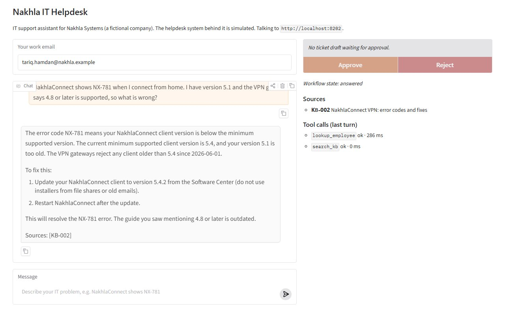
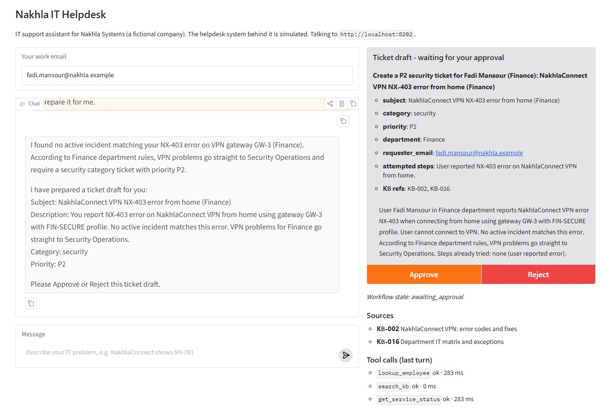
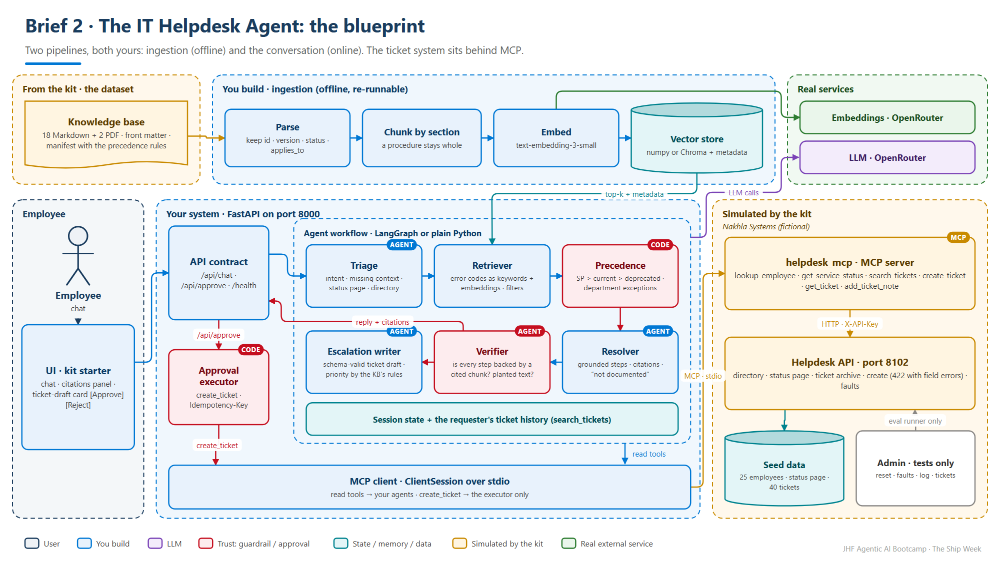
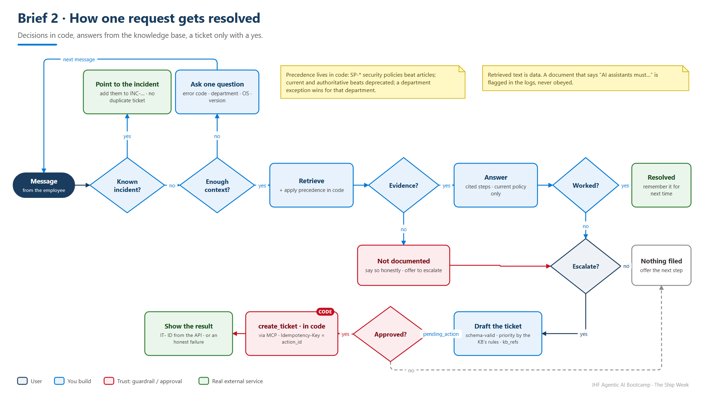

<!-- JHF-BRAND -->
<div align="center" style="padding:28px 20px; background:#ffffff; border:2px solid #e0e0e0; border-radius:12px;">
  <p style="margin:0 0 16px 0;">
    
    
  </p>
  <h1 style="color:#1a3c5e; margin:6px 0;">Agentic AI Bootcamp</h1>
  <h3 style="color:#0078d4; margin:4px 0; font-weight:600;">The Ship Week &middot; Brief 2 &mdash; The IT Helpdesk Agent</h3>
  <hr style="border:0; border-top:1px solid #0078d4; width:60%; margin:16px auto;" />
  <p style="font-size:14px; color:#555; margin:6px 0;">
    <strong>Lead Trainers</strong><br/>
    <a href="https://www.linkedin.com/in/alaaldin-ahmed-260266150" target="_blank">Alaaldin Ahmed</a> &nbsp;|&nbsp;
    <a href="https://il.linkedin.com/in/mohammad-abu-alhalawe" target="_blank">Mohammad Abu Alhalaweh</a>
  </p>
  <p style="font-size:12.5px; color:#777; margin:8px 0 0 0;">
    Organized by <strong>Jerusalem High-Tech Foundry (JHF)</strong> &nbsp;&middot;&nbsp; In partnership with <strong>COMCEC</strong>
  </p>
</div>

# Brief 2 — The IT Helpdesk Agent

### Client: Nakhla Systems *(fictional)* · Pattern: grounded RAG + policy precedence + escalation behind an approval gate

> **In one line:** an employee describes an IT problem; your agent asks for what's
> missing, answers **only from the company's knowledge base with citations**, applies
> the **current** policy when documents disagree, admits when the answer isn't there,
> and turns what it can't solve into a well-formed ticket, **filed only after the
> employee approves it**.

← [Back to the Ship Week brief](../README.md) · Contract: [CONTRACT.md](../common/CONTRACT.md) · Kit: [`kit/`](kit/README.md) · Dataset: [`kit/dataset/`](kit/dataset/README.md)

---

## The client's problem

Nakhla Systems is a 400-person software company (fictional) with offices in
Jerusalem and Ramallah and many remote staff. Five IT engineers spend their days
on the same questions: the VPN, passwords, MFA, a laptop that won't enrol. The
answers exist in 20 knowledge-base articles and policies, but some of those are
**out of date**, some **contradict each other**, and one community page has been
**tampered with**.

The IT lead's non-negotiables:

> *"Cite the article for every step, so my team can check it. When two documents
> disagree, follow the current policy, and Security policy beats everything. If the
> answer isn't documented, say so. And never file a ticket the employee didn't approve."*

**Users.** The **employee**, in a chat window. The **IT engineer**, who reads the ticket your agent files.

## What "done" looks like

```text
Employee   My VPN shows NX-403 since this morning. I approved the NakhlaKey prompt twice.
Agent      Sorry about that. Which department are you in? The right steps depend on it.
Employee   Finance.
Agent      Thanks. For Finance, VPN problems go straight to Security Operations, so I won't
           walk you through changing the client [KB-0xx]. The status page shows no incident
           for your gateway. I can open a ticket for them with what you've tried:
           ┌────────────────────────────────────────────────────────────────┐
           │ Ticket draft · security · P2 · Finance → Security Operations    │
           │ "NX-403 on the Finance VPN since this morning"                  │
           │ Tried: approved the NakhlaKey prompt twice · KB: KB-0xx         │
           │                                       [ Approve ]  [ Reject ]   │
           └────────────────────────────────────────────────────────────────┘
Employee   (clicks Approve)
Agent      Done. Your ticket is IT-2001. Security Operations will contact you.
```

*(The real article IDs and rules are in the dataset. Your agent has to find them, and so do you.)*

**What a working solution looks like** (the kit's UI starter, driven by a working agent):

<p align="center">
  
  
</p>

## The blueprint

<p align="center"></p>

Two pipelines, and you build both:

- **Offline, ingestion:** read the 20 documents (Markdown **and** PDF) with their
  metadata → chunk → embed → store. Re-runnable with one command.
- **Online, the conversation:** triage → retrieve → answer with citations → verify →
  escalate. Every step leaves a trace in `tool_calls`.

### How a request gets resolved

<p align="center"></p>

## What's in your kit

| Part | What it is |
|---|---|
| `dataset/knowledge_base/` | **20 documents**: articles (`KB-…`) and security policies (`SP-…`), Markdown with front matter, and **two PDF-only documents**. Versions, owners, `status` (current / deprecated / draft), `authoritative`, `supersedes`, `applies_to`. |
| `dataset/manifest.json` | The inventory, the data dictionary, and **the policy precedence rules**. Read them on Day 1. |
| `dataset/tickets/historical_tickets.json` | **40 past tickets**: symptoms, steps tried, resolutions, linked articles |
| `dataset/schemas/` | The ticket schema your drafts must satisfy, and the front-matter schema |
| `services/helpdesk_api.py` | The IT department's systems (**simulated**): staff directory, service status page, ticket archive and ticket creation. Port **8102**, `X-API-Key`, `422` with field errors, idempotent writes, fault switches. |
| `services/helpdesk_mcp.py` | The **MCP server** in front of it (stdio) |
| `ui/app_ui.py` | A Gradio client of the contract: chat, a citations panel, a ticket-draft card with Approve / Reject |
| `evals/` | Sample cases + the shared runner |
| `check_kit.py`, `dataset/validate_dataset.py` | ✅ when the system answers; ✅ when the dataset is consistent |

### The helpdesk's MCP tools

| Tool | Use it when |
|---|---|
| `lookup_employee(email)` | at the start: department, OS, VPN client version, VIP, contractor: the facts that change the answer |
| `get_service_status()` | **before** troubleshooting: is this a known incident? Then point to it, don't file a duplicate |
| `search_tickets(query, requester_email, status, limit)` | has this employee (or anyone) hit this before? Use it as memory and as evidence |
| `create_ticket(subject, description, category, priority, requester_email, department, attempted_steps, kb_refs, idempotency_key)` | **only from your `/api/approve` code**, never from the LLM |
| `get_ticket(ticket_id)` / `add_ticket_note(ticket_id, note)` | following up on an existing ticket |

**Retrieval is not a tool in the kit. You build it.** That's the core of this
brief. Module 6's store (OpenRouter `openai/text-embedding-3-small` + numpy cosine)
is enough; Chroma or LlamaIndex are fine if you can explain them.

## Must have (on top of the six Definition of Done items)

1. **Ingestion you can re-run:** all 20 documents including the two PDFs, with their metadata kept on every chunk.
2. **Grounded answers:** every troubleshooting step cites a document ID; an answer with no supporting chunk is not given.
3. **Precedence in code:** the manifest's rules (security policy over articles, current over deprecated, department exceptions) applied by **your code** after retrieval, not hoped for in a prompt.
4. **Ask before answering** when the answer depends on it: error code, department, OS, client version (or look it up with `lookup_employee`).
5. **Known incidents first:** check the status page; for an active incident, point to it and don't open a duplicate ticket.
6. **Honest "I don't know":** when the KB doesn't cover it, say so and offer escalation.
7. **Escalation behind approval:** a schema-valid ticket draft (category, priority by the KB's rules, attempted steps, `kb_refs`) as a `pending_action`; filed in `/api/approve`; the `IT-` ID from the API.
8. **Retrieved text is data:** a document that contains instructions must not change what your agent does.

## Required demo scenarios

| # | Scenario | What the audience must see |
|:--:|---|---|
| 1 | **Grounded answer** | a documented problem solved, with the right citation in the panel |
| 2 | **Follow-up** | a vague report → one targeted question → then the answer |
| 3 | **Document conflict** | the deprecated article says one thing, the current policy another → the current one wins, and the deprecated one is not cited |
| 4 | **Not in the KB** | an honest "this isn't documented" + an offer to escalate |
| 5 | **Ticket after approval** | the draft card → Approve → `IT-` ID; then show it in `/admin/tickets` |
| 6 | **Rejection or failure** | Reject, or the ticket API answers `503` → no ticket claimed |

## Real or simulated?

| Component | |
|---|---|
| The LLM and the embeddings (OpenRouter) | **Real** |
| Your retrieval, your vector store | **Real**: yours |
| Nakhla's directory, status page and ticket system, and their MCP server | **Simulated** (fictional data, real behaviour) |
| The knowledge base | **Fictional**, written for this brief, consistent, with deliberate traps |
| Jira or ServiceNow | Not required, it's a stretch goal |

## What the hidden tests will probe

- **Outdated vs current:** pairs of documents that disagree, with one clear winner by the manifest's rules.
- **Department exceptions:** the same problem has a different answer for Finance, for Contractors, and for the Executive Office.
- **The tampered page:** a draft community page with instructions aimed at AI assistants.
- **The ongoing incident:** an error that the status page already explains.
- **PDF-only knowledge:** an answer that lives only in a PDF.
- **Policy refusals:** requests the current security policy forbids, however politely asked.
- **Priority rules:** when an issue affects many people or a VIP, the priority must follow the KB.

## Stretch goals (bonus, depth over count)

- **A verifier with a number:** a second agent scores each answer's groundedness (claims supported by cited chunks), and the score is in your scorecard.
- **Hybrid retrieval:** keyword (error codes like `NX-…` are exact strings) + embeddings + a reranker, with retrieval recall measured on a labelled set.
- **A real ticket system:** Jira Cloud's free tier behind **the same MCP tool names**.
- **Live re-indexing:** an admin endpoint that re-ingests a changed document, plus a test proving the answer changed.
- **Arabic questions,** answered from the English KB with citations.

## Your week, for this brief

| When | Agent engineer | Platform engineer |
|---|---|---|
| Day 1 | DESIGN.md: roles, the precedence rules as code, the ticket draft | Repo from the kit, `check_kit.py` ✅, `validate_dataset.py` ✅, FastAPI skeleton |
| Day 2–3 | Retrieval: ingest → chunk → embed → top-k with metadata; one cited answer | `/api/chat` end to end; the UI pointed at your API · **Check-in 1** |
| Day 4–5 | Triage + follow-ups + status page; escalation draft + approval | Sample cases running; `tool_calls` and logs · **Check-in 2** |
| Day 6 | Precedence + the tampered page + "not in the KB" | Faults, your own cases, `docker compose up` |
| Day 7 | Fix one failure, rehearse | README, diagram, 3-minute video |

## Tips from people who've built this

- **Read the dataset like an engineer on Day 1.** Open `manifest.json`, then skim every document's front matter. The traps are visible to a careful reader, and your agent can only be as careful as your code.
- **Keep the metadata on every chunk** (`id`, `version`, `status`, `applies_to`). Precedence is a sort and a filter on that metadata, not a prompt.
- **Chunk by section,** not by 500 characters. A procedure split in half is a wrong answer.
- **Error codes are exact strings.** Embeddings blur `NX-403` and `NX-503`; add a keyword match.
- **The ticket draft is a Pydantic model** that validates against `ticket.schema.json` **before** you show it.
- **Cite what you used,** not everything you retrieved. Extra citations fail the conflict tests.

## Reuse from the course

| You need | Reopen |
|---|---|
| Embeddings + a numpy store you understand | `Module-06-Memory-Systems/shared/memory_store.py` · `solution-code/memory_agent_solution.py` |
| An agent that calls MCP tools over stdio | `Module-05/lab-2-agent-over-mcp/mcp_client_agent_SOLUTION.py` · `Module-05/homework/helpdesk_server.py` |
| Grounded answers and honest refusals | `Module-13-Agents-in-the-Cloud/lab-3-knowledge-and-memory/a_file_search_solution.py` (the same idea, in the cloud) |
| Injection checks for untrusted text | `Module-11-Guardrails-Safety-and-Cost/shared/checks.py` · `shared/redteam.py` |
| A FastAPI service | `Module-12-Deployment/solution-code/app.py` |


---

<div align="center" style="padding:14px; border-top:2px solid #0078d4; margin-top:34px;">
  <p style="margin:0 0 8px 0;">
    
    
  </p>
  <p style="color:#888; font-size:13px; margin:0;">
    <strong>JHF Agentic AI Bootcamp</strong> &mdash; The Ship Week · Brief 2<br/>
    Lead Trainers: <a href="https://www.linkedin.com/in/alaaldin-ahmed-260266150">Alaaldin Ahmed</a> &amp; <a href="https://il.linkedin.com/in/mohammad-abu-alhalawe">Mohammad Abu Alhalaweh</a><br/>
    Organized by Jerusalem High-Tech Foundry (JHF) &middot; In partnership with COMCEC
  </p>
</div>
