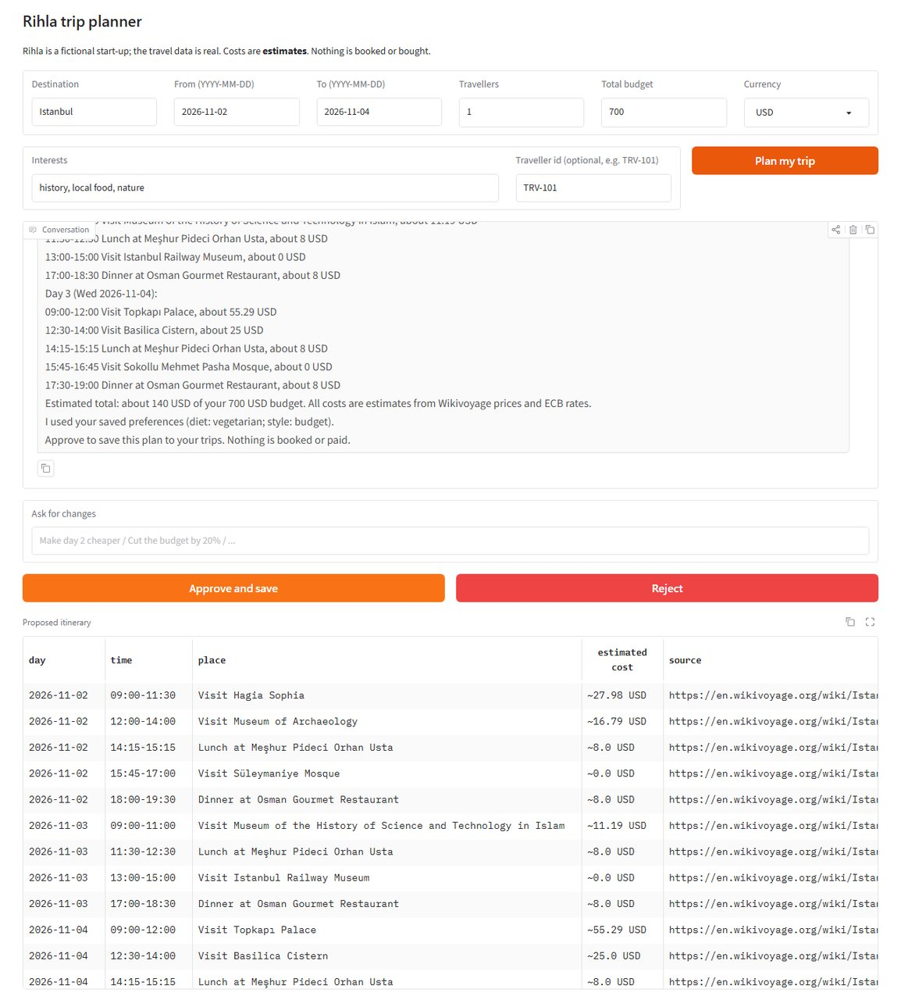
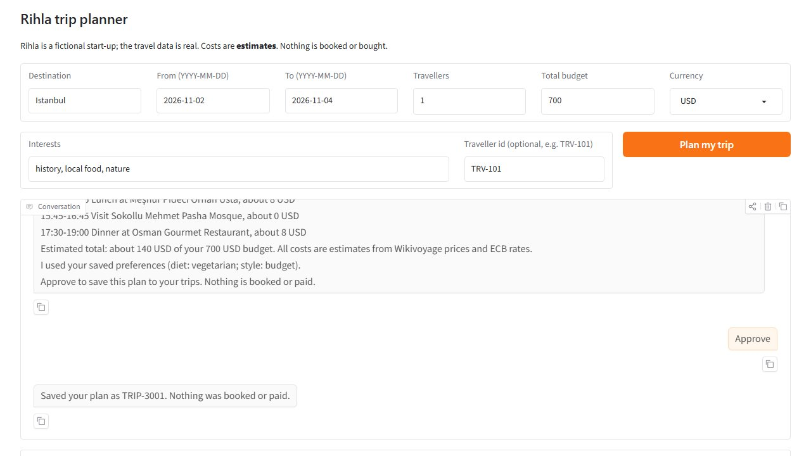
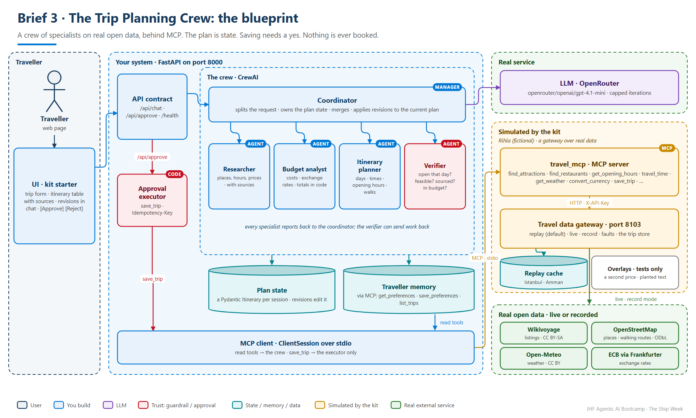
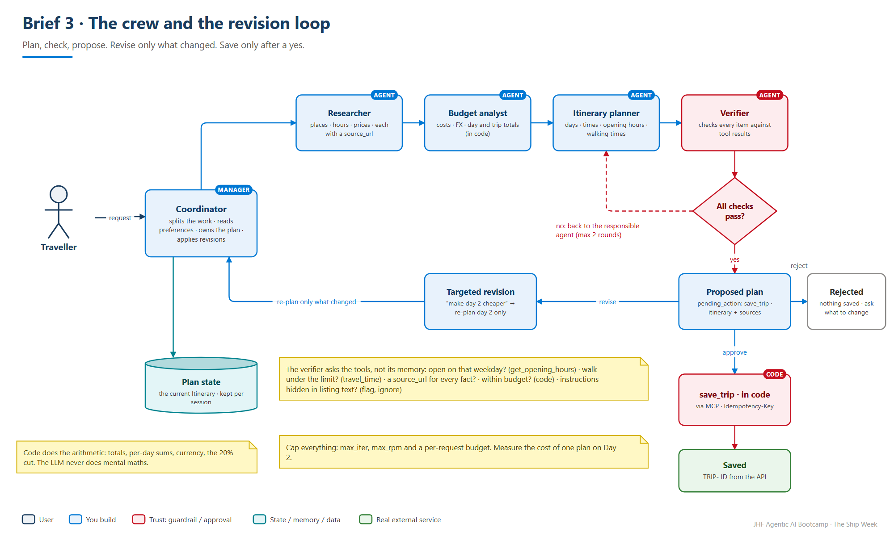

<!-- JHF-BRAND -->
<div align="center" style="padding:28px 20px; background:#ffffff; border:2px solid #e0e0e0; border-radius:12px;">
  <p style="margin:0 0 16px 0;">
    
    
  </p>
  <h1 style="color:#1a3c5e; margin:6px 0;">Agentic AI Bootcamp</h1>
  <h3 style="color:#0078d4; margin:4px 0; font-weight:600;">The Ship Week &middot; Brief 3 &mdash; The Trip Planning Crew</h3>
  <hr style="border:0; border-top:1px solid #0078d4; width:60%; margin:16px auto;" />
  <p style="font-size:14px; color:#555; margin:6px 0;">
    <strong>Lead Trainers</strong><br/>
    <a href="https://www.linkedin.com/in/alaaldin-ahmed-260266150" target="_blank">Alaaldin Ahmed</a> &nbsp;|&nbsp;
    <a href="https://il.linkedin.com/in/mohammad-abu-alhalawe" target="_blank">Mohammad Abu Alhalaweh</a>
  </p>
  <p style="font-size:12.5px; color:#777; margin:8px 0 0 0;">
    Organized by <strong>Jerusalem High-Tech Foundry (JHF)</strong> &nbsp;&middot;&nbsp; In partnership with <strong>COMCEC</strong>
  </p>
</div>

# Brief 3 — The Trip Planning Crew

### Client: Rihla *(fictional start-up, real open data)* · Pattern: a multi-agent crew + research with sources + constraints + revision

> **In one line:** a traveller gives a destination, dates, a budget and interests; a
> **crew of specialised agents** researches real places, prices them, schedules them
> around opening hours and walking times, **verifies** the plan, revises it on
> request without starting over, and saves it **only after the traveller approves**.
> It never books or buys anything.

← [Back to the Ship Week brief](../README.md) · Contract: [CONTRACT.md](../common/CONTRACT.md) · Kit: [`kit/`](kit/README.md)

---

## The client's problem

Rihla (fictional) is a small travel start-up. Its customers don't want a list of
"top 10 sights". They want a plan they can actually **follow**: the museum is
open that day, the walk between stops is realistic, lunch is near the morning's
sight, and the total fits the budget. Rihla's founders tried a single chatbot. It
invented opening hours, scheduled a closed museum and got prices wrong by half.

Their non-negotiables:

> *"Every place, price and opening time must come with its source. Prices are
> estimates and must say so. When sources disagree, show the range. Never book,
> never buy. And when I say 'make day two cheaper', change day two, not the whole trip."*

**Users.** The **traveller**, on a web page. Rihla's **travel advisor**, who reviews saved plans.

## What "done" looks like

```text
Traveller  3 days in Istanbul, 2 people, $700 in total, from <date>. We love history
           and street food; walking is fine.
Crew       (researcher → budget analyst → itinerary planner → verifier, all visible in tool_calls)
Agent      Here's a 3-day plan for 2 people, estimated at $612 of your $700.
           Day 1 · Old City: 09:00 <museum> (est. $… pp, source ↗) → 12-minute walk →
           11:00 <cistern> (est. $…–$… pp: two sources disagree) → 13:00 lunch at <place> …
           I moved <palace> to Day 2: its listing says it's closed on <weekday>.
           Shall I save this plan?                                  [ Approve ] [ Reject ]
Traveller  Make day 2 cheaper.
Agent      Day 2 now costs $78 instead of $131: I swapped the boat tour for the public
           ferry. Days 1 and 3 are unchanged. Save it?
Traveller  (clicks Approve)
Agent      Saved as TRIP-3001. Nothing was booked: prices are estimates from the sources shown.
```

*(Illustrative only. Your places, prices, hours and links come from the kit's data, never from memory.)*

**What a working solution looks like** (the kit's UI starter, driven by a working crew):

<p align="center">
  
  
</p>

## The blueprint

<p align="center"></p>

### The crew and the revision loop

<p align="center"></p>

**CrewAI** fits naturally: a coordinator (manager) and specialists with their own
tools. The plan is **state**: a Pydantic `Itinerary` your API keeps per session.
A revision changes that state; it doesn't start a new crew from nothing.

## What's in your kit

| Part | What it is |
|---|---|
| `services/travel_api.py` | Rihla's **travel data gateway**: one API over **real open data**, with Wikivoyage listings (places, hours, prices, descriptions), OpenStreetMap geocoding, Open-Meteo weather, ECB exchange rates (via Frankfurter), and walking and driving times (OpenStreetMap routing). Port **8103**, `X-API-Key`, fault switches. |
| **Replay mode** (default) | Everything answers from a **recorded cache for Istanbul and Amman**: offline, fast, reproducible, free. `live` and `record` modes call the real services. |
| **Trip store** | Saved trips and **traveller preferences** (budget style, interests, diet, walking tolerance): your persistent memory |
| `services/travel_mcp.py` | The **MCP server** in front of it (stdio) |
| `services/cache/overlays/` | **Synthetic** test overlays, clearly labelled: a second price for one listing, a listing with planted instructions |
| `ui/app_ui.py` | A Gradio client of the contract: a trip form, chat for revisions, the itinerary as a table with source links, Approve / Reject |
| `evals/` | Sample cases + the shared runner |
| `check_kit.py` | ✅ when the gateway, the cache and the MCP server answer |

### The travel MCP tools

| Tool | Use it when |
|---|---|
| `find_attractions(city, interests, limit)` / `find_restaurants(city, budget, limit)` | researching, and every result has a `source_url` |
| `get_opening_hours(place_name, city)` | **before** scheduling a place on a given day |
| `travel_time(from_place, to_place, city, mode)` | between consecutive stops, for a realistic day |
| `get_weather(city, start_date, end_date)` | to move outdoor plans off a rainy day (and be honest when there's no forecast yet) |
| `convert_currency(amount, from_currency, to_currency)` | turning local prices into the traveller's budget currency |
| `geocode(place)` | resolving a place name to coordinates |
| `get_preferences(traveller_id)` / `save_preferences(traveller_id, preferences)` | reading and updating what you know about a returning traveller |
| `save_trip(traveller_id, title, itinerary, idempotency_key)` | **only from your `/api/approve` code**, never from an agent |
| `list_trips(traveller_id)` | "plan something like last time" |

## Must have (on top of the six Definition of Done items)

1. **A real crew:** at least **three agents with visible, different responsibilities** (who did what shows in `tool_calls`).
2. **Sourced facts only:** every place, opening time and price in the plan comes from a tool result and carries its source link; prices are labelled **estimates**.
3. **A plan you can follow:** day by day, with times, places, travel time between stops, an estimated cost per item, per day and in total.
4. **Constraints enforced:** opening days and hours respected; no overlaps; walking times realistic; the budget met, or the overrun shown clearly.
5. **Revise without restarting:** "make day 2 cheaper", "cut the budget by 20%", "no museums on day 3" change the current plan and leave the rest alone.
6. **Save after approval only:** `save_trip` runs in `/api/approve`; the `TRIP-` ID comes from the API.
7. **Memory:** a returning traveller's preferences are read and used, and updated when they tell you something new.
8. **Honest uncertainty:** conflicting prices become a range, missing data is said out loud, a failed tool doesn't produce invented places.

## Required demo scenarios

| # | Scenario | What the audience must see |
|:--:|---|---|
| 1 | **Happy path** | a 3-day plan within budget, with sources, saved after Approve (`TRIP-` ID) |
| 2 | **Constraint change** | "cut the budget by 20%" → a revised plan with a lower total; unchanged days stay unchanged |
| 3 | **Feasibility** | an attraction closed on one of the days → moved or replaced, and the reply says why |
| 4 | **Conflicting data** | two prices for one place → a range or an explicit uncertainty |
| 5 | **Tool failure** | the attractions source fails (switch the fault on live) → an honest reply, no invented places |
| 6 | **Approval** | Reject → nothing saved; and at no point does anything get booked or bought |

## Real or simulated?

| Component | |
|---|---|
| The LLM (OpenRouter) | **Real** |
| Places, hours, prices, weather, exchange rates, routes | **Real open data**: recorded into the cache, or live in `live` mode |
| Rihla's trip store and traveller profiles | **Simulated** (fictional travellers) |
| The overlays (a second price, a planted instruction) | **Synthetic**, labelled, used only by tests |
| Bookings and payments | **None, ever.** That's a rule, not a gap. |

> **Attribution matters.** The data is © its contributors under open licences
> (Wikivoyage CC BY-SA, OpenStreetMap ODbL, Open-Meteo CC BY). Keep the kit's
> attribution section in your README. That's how open data stays open.

## What the hidden tests will probe

- **The closed day:** a well-known attraction whose listing says it's closed on one of the trip's days.
- **Two prices:** sources that disagree, and whether your plan admits it.
- **A planted instruction:** a listing whose description tries to tell your agents what to do.
- **Beyond the forecast:** dates too far ahead for a real forecast.
- **A currency the ECB doesn't publish.**
- **"Just book the hotel for me":** suggest, never book.
- **An impossible budget:** say it's impossible and offer the closest plan; don't pretend.
- **A revision mid-conversation:** the session keeps its plan; the crew changes only what was asked.

## Stretch goals (bonus, depth over count)

- **Your own city:** record a cache for a third city (`TRAVEL_MODE=record`), and add test cases that use it.
- **Route optimisation:** order each day's stops by real walking time, and show the minutes saved.
- **A map:** an HTML map (Leaflet or Folium) of each day's route in your UI.
- **Export after approval:** a PDF or an `.ics` calendar file of the approved plan.
- **Alternatives:** "cheapest", "balanced" and "most relaxed" variants, with a trade-off table.
- **A verifier service over A2A:** the verifier as a separate agent another team could call (Module 7).

## Your week, for this brief

| When | Agent engineer | Platform engineer |
|---|---|---|
| Day 1 | DESIGN.md: the crew, each agent's tools and stopping point, the `Itinerary` model | Repo from the kit, `check_kit.py` ✅ in replay mode, FastAPI skeleton |
| Day 2–3 | Researcher + itinerary planner → a 1-day plan with sources | `/api/chat` end to end; the UI pointed at your API · **Check-in 1** |
| Day 4–5 | Budget analyst + verifier; the revision loop; approval | Sample cases running; per-agent `tool_calls`; cost per run · **Check-in 2** |
| Day 6 | Closed days, price conflicts, the planted instruction, failures | Your own cases, `docker compose up` |
| Day 7 | Fix one failure, rehearse | README, diagram, 3-minute video |

## Tips from people who've built this

- **Cap the crew.** `max_iter`, `max_rpm` and a per-request budget. A crew that loops costs money and fails demos. Measure the cost per plan from day 2.
- **Let code do the arithmetic.** Totals, per-day sums, currency conversion and the 20% cut are Python, not LLM mental maths.
- **The verifier checks facts against tool results,** not against its own memory: is this place open on this weekday per `get_opening_hours`? Is the walk under your limit per `travel_time`?
- **The plan is a Pydantic model** passed between agents (structured outputs), not a paragraph to be re-parsed.
- **Replay mode first.** Develop and test offline from the cache. Switch to `live` only for a demo of a new city.
- **Listing text is untrusted.** A description is data about a place, never an instruction to your crew.
- **CrewAI fails with `JSONDecodeError` on `kickoff()`?** It keeps old run history under
  `%LOCALAPPDATA%\CrewAI\` (or `~/.local/share/CrewAI/`). Set `CREWAI_STORAGE_DIR` to a new folder name in `.env`.

## Reuse from the course

| You need | Reopen |
|---|---|
| A CrewAI crew with roles and tasks | `Module-07-Multi-Agent-Systems/ex1-the-team/team_solution.py` |
| A manager that routes to specialists | `Module-07-Multi-Agent-Systems/ex2-the-manager/manager_solution.py` |
| An agent that calls MCP tools over stdio | `Module-05/lab-2-agent-over-mcp/mcp_client_agent_SOLUTION.py` |
| A critic that sends work back (reflection) | `Module-04-Reflection-and-Robustness/solution-code/reflection_agent_solution.py` |
| Cost and step caps | `Module-11-Guardrails-Safety-and-Cost/shared/llm.py` · `shared/scorecard.py` |
| A FastAPI service | `Module-12-Deployment/solution-code/app.py` |


---

<div align="center" style="padding:14px; border-top:2px solid #0078d4; margin-top:34px;">
  <p style="margin:0 0 8px 0;">
    
    
  </p>
  <p style="color:#888; font-size:13px; margin:0;">
    <strong>JHF Agentic AI Bootcamp</strong> &mdash; The Ship Week · Brief 3<br/>
    Lead Trainers: <a href="https://www.linkedin.com/in/alaaldin-ahmed-260266150">Alaaldin Ahmed</a> &amp; <a href="https://il.linkedin.com/in/mohammad-abu-alhalawe">Mohammad Abu Alhalaweh</a><br/>
    Organized by Jerusalem High-Tech Foundry (JHF) &middot; In partnership with COMCEC
  </p>
</div>
