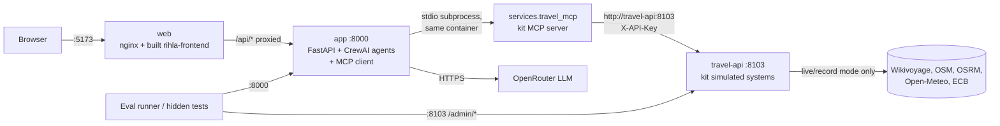

# Running Rihla with Docker

One command starts the whole system (Definition of Done #6: "one-command start (`docker compose up`)").

```powershell
cd Final-Mini-Project/scenario-3-trip-planner/kit
copy .env.example .env          # once; fill in the values you need (below). .env is git-ignored.
docker compose up --build       # first run builds the images (a few minutes: CrewAI is large)
```

| Open | What it is |
|---|---|
| http://localhost:5173 | The Rihla web app |
| http://localhost:8000/health | The Rihla API (`POST /api/chat`, `POST /api/approve`, `GET /api/trips`, `/api/auth/*`) |
| http://localhost:8103/health | The kit's simulated travel API (replay mode by default) |

Stop:

```powershell
docker compose down             # stops and removes these three containers; no volumes are used
```

## Services



| Service | Image | Port | Starts after |
|---|---|---|---|
| `travel-api` | `services/Dockerfile` (the kit's, unchanged) | 8103 | — |
| `app` | `Dockerfile` (Python 3.12, the kit's pinned `requirements.txt` without gradio, non-root user) | 8000 | `travel-api` healthy |
| `web` | `docker/frontend.Dockerfile` (`npm ci` + `vite build`, then nginx with `docker/nginx.conf`) | 5173 → 80 | `app` healthy |

- The MCP server is not a separate container. The backend's MCP client (`researcher/mcp_client.py`) starts `python -m services.travel_mcp` as a **stdio subprocess** inside the `app` container. That server calls the travel API at `TRAVEL_API_URL=http://travel-api:8103`, which compose sets for the `app` service.
- `web` serves the built page and forwards `/api/*` to `app`, so the page and the API share one origin, as the Vite dev proxy does. This lets the sign-in cookie work, and `http://localhost:5173` is already in the backend's default `RIHLA_ALLOWED_ORIGINS`.
- Every service has a health check (`GET /health`, or `/` for `web`), and `depends_on` waits for it.

## Settings

Compose reads `kit/.env`, the same file a laptop run uses. Values are passed in at run time and are never copied into an image (`.dockerignore` excludes every `.env*` file).

| Variable | Used by | Needed for |
|---|---|---|
| `OPENROUTER_API_KEY` | app | Planning a trip (the LLM). Without it `/api/chat` answers with an error, and nothing else breaks. |
| `TRAVEL_TRAVELLER_ID` | app | Saving an approved trip for anonymous callers (e.g. `TRV-200`); see `.env.example` |
| `TRAVEL_API_KEY` | travel-api, app | Shared key (default `dev-key-change-me`). Compose gives both services the same value. |
| `TRAVEL_MODE`, `TRAVEL_TODAY`, `TRAVEL_OVERLAYS`, `TRAVEL_CONTACT` | travel-api | `replay` (default, offline) / `live` / `record`; see the kit README |
| `RIHLA_FIREBASE_PROJECT_ID`, `RIHLA_SESSION_SECRET`, `RIHLA_AUTH_REQUIRED`, … | app | Google sign-in (`app/auth/INTEGRATION.md`). Unset: sign-in is off and the API is open, as the eval runner needs. |
| `VITE_ENABLE_LIVE_AI`, `VITE_FIREBASE_*` | web (build time) | Put them in `kit/.env` or the shell for Docker. `rihla-frontend/.env.local` is for `npm run dev` only and is not read by the image build. Rebuild `web` after a change: `docker compose up --build web`. |
| `TRAVEL_API_PORT`, `RIHLA_APP_PORT`, `RIHLA_WEB_PORT` | compose | Host ports if 8103, 8000 or 5173 are taken (defaults are the documented ports) |

`TRAVEL_API_URL` in `.env` (`http://localhost:8103` for a laptop run) is overridden inside Docker. You do not need to change it.

`RIHLA_ENV` is `development` in `docker-compose.yml`, the file for local use. In development, flight search shows labelled DEMO data.

## Production: always add `docker-compose.prod.yml`

`docker-compose.yml` on its own is for local use. For anything public, add the production overlay:

```powershell
# TRAVEL_API_KEY must be a private value (kit/.env or the shell); compose refuses to start if it is unset or empty.
docker compose -f docker-compose.yml -f docker-compose.prod.yml config --quiet
docker compose -f docker-compose.yml -f docker-compose.prod.yml up -d --build --wait
```

**What the overlay does:**
- It sets `RIHLA_ENV=production` literally. No `.env` or shell value can turn it back.
  - Flight search then never shows DEMO or TEST prices.
  - Open-Meteo weather and city search run only after the licence decision (`RIHLA_OPEN_METEO_API_KEY` or `RIHLA_OPEN_METEO_NONCOMMERCIAL=true`).
- It requires `TRAVEL_API_KEY` to be set and not empty. It can't tell whether the value is private: a literal `dev-key-change-me` is accepted, so check it yourself.
- It publishes only the web port: 8000 and 8103 stay inside Docker.

It needs Docker Compose 2.24 or newer. It does **not** make Rihla production-ready on its own: see `docs/deployment-readiness.md`, which covers the blockers, among them saved trips that are kept in memory only.

## Evals and tests against the containers

```powershell
python evals/run_evals.py          # uses APP_URL=http://localhost:8000 and TRAVEL_API_URL=http://localhost:8103
```

Running the eval cases makes real OpenRouter calls (they plan trips); budget accordingly.

## Tested (2026-11-02, Docker 29.8.2, Compose v5.6.0, branch `feature/destinations-flights` on `3d9fd86`)

No LLM call was made; `travel-api` ran in replay mode.

| Check | Result |
|---|---|
| `docker compose config` | valid |
| Build | 3 images: `app` 1.4 GB, `travel-api` 205 MB, `web` 75 MB (first build about 20 min on a slow connection; then cached) |
| Image contents | `app` runs as the non-root `rihla` user; has only `app/`, `planning/`, `researcher/`, `services/{__init__,travel_mcp}.py`; no `.env`, `.venv`, tests or gradio. `web` has only the built files. |
| Start-up | all three `healthy` 13 s after `up -d`, in order `travel-api` → `app` → `web` |
| Host endpoints | `:8103/health`, `:8000/health`, `:5173/` 200; `/my-trips` falls back to the SPA; `:5173/api/auth/config` and `:5173/health` reach `app` through nginx |
| app → travel-api | REST by service name with the shared key (`/api/hours` Topkapı, closed Tue); the app's own `trip_store.list_trips_from_store` / `get_trip_from_store` work |
| MCP inside `app` | `python -m services.travel_mcp` starts over stdio (cwd `/app`) and lists 11 tools; `get_opening_hours`, `find_attractions`, `travel_time`, `get_weather` answer ok from the replay cache; `save_trip` / `save_preferences` are refused to agents; the travel API log shows every call |
| Logs | no errors or tracebacks |
| `docker compose down` | containers and network removed; no volumes |

Not tested: a full trip (`/api/chat` with a valid request calls the paid LLM), Google sign-in (needs the Firebase settings), and `TRAVEL_MODE=live`.

## Useful commands

```powershell
docker compose ps                                   # status and health
docker compose logs -f app                          # backend log (errors carry an error id)
docker compose exec app python -c "from researcher.mcp_client import call_read_tool; print(call_read_tool('geocode', {'place': 'Amman Citadel'})['ok'])"
docker compose up --build app                       # rebuild one service after a code change
```
