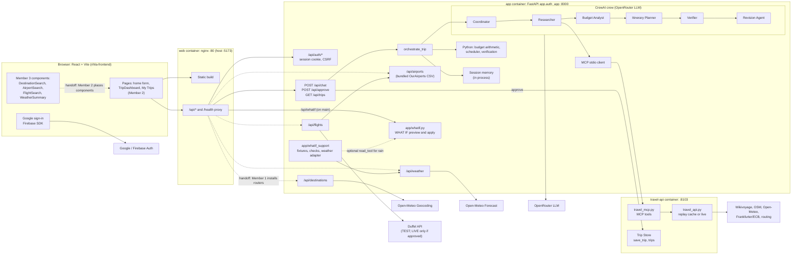

# Rihla: architecture and feature status

**What this document is:**
- A draft by Member 3, written on 2026-11-03 from the code on branch `feature/destinations-flights` (started from `main` at `3d9fd86`).
- Updated the same day after `main` moved to `6df209d` (PR #15, which merged WHAT IF, approval and sign-in work). `main` was read read-only; this branch is not merged into it yet.
- It is kept under `docs/` so that it doesn't overwrite the shared `README.md`, which is the official kit's.

**Status words used here:**

| Word | Meaning |
|---|---|
| **Tested** | Implemented, with automated tests passing on this branch |
| **Not integrated** | Works in isolation, but isn't wired into the running app |
| **Pending merge** | Exists on another branch |
| **Proposed** | Not built |
| **Unverified** | Not checked against the real service |

## 1. Product

**Rihla** is an agentic AI trip planner.

- A traveller gives a destination, dates, a budget and interests.
- A crew of specialised agents researches real places (Wikivoyage, OpenStreetMap, Open-Meteo, ECB rates), prices them, schedules them and verifies the plan.
- The plan is saved only after the traveller approves it.

**Rules from the official scenario (`README.md`):**
- every place, opening time and price comes with its source;
- prices are estimates;
- nothing is saved without approval.

**Main user journey:**
1. Sign in with Google.
2. Fill in the trip form: destination, dates, travellers, budget, interests.
3. The crew plans. The traveller sees the itinerary, the budget, the verification and the sources.
4. The traveller asks for changes, which become targeted revisions. A WHAT IF can be tried as well (on `main`, see §5).
5. **Approve** saves the trip (`TRIP-…`). It then appears in **My Trips** and can be exported to PDF.

## 2. Team

| Member | Owns |
|---|---|
| **Member 1** | AI agents and orchestration (Coordinator, Researcher, Budget Analyst, Itinerary Planner, Verifier, Revision Agent); the WHAT IF simulation; approval; trip persistence; memory; MCP and the travel API integration; `app/main.py`; evals |
| **Member 2** | Authentication (Firebase / Google); the main pages (`App.jsx`, `TripDashboard.jsx`, My Trips); revision chat UI; the WHAT IF UI; navigation; PDF export |
| **Member 3** | External integrations (destinations, airports, flights, weather); WHAT IF fixtures and data adapters; Docker; deployment and architecture docs; demo preparation |

## 3. System architecture

The diagram follows the code. **Dashed lines are not wired yet:** each needs a handoff, or is on an unmerged branch.

**About the diagram:**
- **Syntax:** checked by hand against Mermaid's `flowchart` syntax. It was not rendered by a Mermaid tool in this environment.
- **The MCP client:** `researcher/mcp_client.py` starts `python -m services.travel_mcp` over stdio, and calls only read tools.
- **The MCP server process runs inside the app container.** That is why the app image copies `services/travel_mcp.py`.
- **The data comes from the `travel-api` container,** over HTTP (`TRAVEL_API_URL`).
- So in the diagram, "MCP tools" sit with the travel API, which is where their data lives.

## 4. AI agent architecture

This is from the code, with Member 1 as owner. **The LLM decides; Python calculates and checks.**

| Step | Code | What the LLM does | What Python does |
|---|---|---|---|
| Coordinator | `app/coordinator.py` (CrewAI `Agent`, OpenRouter) | Reads the free-text preferences | Form fields are taken as they are |
| Researcher | `researcher/` (CrewAI tools over the MCP client) | Chooses which read-only MCP tools to call | `researcher/validate.py` builds the ResearchBundle from the tool log and drops what can't be trusted. Every place has a `source_url`. |
| Budget Analyst | `planning/budget_analyst.py` | Decides what to spend on | `planning/budget.py` does every sum |
| Itinerary Planner | `planning/itinerary_planner.py` | Chooses the day and order of places | `planning/schedule.py` handles opening hours, visit durations and travel |
| Verifier | `planning/verification.py`, `planning/verifier_agent.py` | Explains and prioritises the findings | Runs the deterministic checks before anything is saved |
| Revision | `planning/revision.py`, `planning/revision_agent.py`, `planning/user_revision.py`, `app/revision.py` | Chooses among feasible alternatives that Python found | Targeted fixes and change requests, keeping unchanged days as they are |
| Approval | `app/main.py` `POST /api/approve` | — | Calls `save_trip` with the exact payload. A trip ID is shown only after the store answered 201. |
| Memory | `app/memory.py` | — | Per-session state, **in process** (lost on restart) |

## 5. Feature status (2026-11-03)

| Area | Status | Notes |
|---|---|---|
| Crew planning, verification, revision | **Tested** on `main` (Member 1) | 1211 backend tests pass on this branch (2026-11-03). 1 known failure in `test_trip_store_integration` (Member 1's file, an uncaught `httpx.HTTPStatusError`). |
| Approval and saving to the Trip Store | **Tested** on `main` | Saving needs `TRAVEL_TRAVELLER_ID`; without it, approval answers 503 |
| Google sign-in | **Tested** on `main` (Member 2) | `app.auth_app`. Protected: `/api/chat`, `/api/approve`, `/api/trips`. |
| My Trips, PDF export | **Tested** on `main` (Member 2) | |
| WHAT IF simulation (`app/whatif.py`, `/api/whatif`, `/api/whatif/apply`) | **On `main`** (PR #15, Member 1) | Tested by Member 1's `tests/test_whatif.py` on `main`. Not re-run in this review. |
| WHAT IF UI (`services/whatIf.js`) | **On `main`** (Member 2) | |
| WHAT IF fixtures and checks | **Tested**, **not integrated** | `docs/whatif.md`. On this branch only. Checked by hand against the real `forecast_rain`, which is the same file now on `main`. The fixtures have not been run through the simulation end to end. |
| Worldwide destination search | **Tested**, **not integrated** | `docs/destinations.md`. Needs Member 1 to install the router and Member 2 to place the component. |
| Airport search | **Tested**, **not integrated** | `docs/airports.md` |
| Flight search | **Tested** with mocks, **not integrated** | `docs/flights.md`. Duffel: **unverified** (no token). DEMO is labelled. Production fails closed. |
| Weather forecast | **Tested**, **not integrated** | `docs/weather.md`. Open-Meteo called live twice to verify. |
| Docker (3 services) | **Tested** locally | `DOCKER.md`, `docs/deployment-readiness.md` |
| Public deployment | **Proposed** | Not deployed. See `docs/deployment-readiness.md`. |

**Seen in the running Docker stack on 2026-11-03:**
- The four Member 3 routes answer **404**, because `app/main.py` doesn't install them yet.
- That is the expected effect of the pending handoffs, not a bug in them.

## 6. External data providers

| Provider | Used by | Terms (checked) | Cost |
|---|---|---|---|
| Open-Meteo Geocoding (GeoNames) | `/api/destinations` | CC BY 4.0, "Location data based on GeoNames". The free API is non-commercial; commercial use needs a paid key on the `customer-` server. In production it's gated by the same licence decision as weather. | Free (non-commercial) |
| OurAirports | `/api/airports` (bundled) | Public domain | Free, offline |
| Duffel | `/api/flights` | TEST free. LIVE: $3 per order, plus $0.005 per search beyond a 1,500:1 search-to-booking ratio. | TEST $0. LIVE **can cost money with no bookings.** |
| Open-Meteo Forecast | `/api/weather` | CC BY 4.0. The free API is non-commercial (fewer than 10,000 calls a day). Commercial use needs a paid plan, whose price isn't published. Production is gated (`app/open_meteo.py`). | Free (non-commercial) |
| Kit's data: Wikivoyage, OSM Nominatim, Open-Meteo, Frankfurter, routing | Crew, through MCP | Replay cache locally. Live mode follows each source's policy (Nominatim: about 1 request per second, with a contact). | Free |
| OpenRouter, `openai/gpt-4.1-mini` | Crew | About $0.40 per million input tokens and $1.60 per million output tokens, from third-party trackers, not the OpenRouter page. **Unverified.** | **The main running cost** (see `docs/deployment-readiness.md`) |
| Firebase Authentication (Google) | Sign-in | Not reviewed in this pass (Member 2) | — |

## 7. Testing strategy

**Backend: pytest, offline by default.**
- External providers are mocked with `httpx.MockTransport`.
- Some fixtures are real recorded answers:
  - Open-Meteo geocoding ("Pari");
  - Open-Meteo forecast (Amman);
  - the kit's Wikivoyage replay data.
- The crew is tested with recorded research and its LLM parts replaced (Member 1).

**Frontend:**
- `node --test` on the pure logic and the API clients;
- ESLint, including the React Hooks rules;
- `vite build`;
- server-side rendering of components for accessibility checks.

**Containers:** `docker compose up --wait`, healthchecks, plus a production-mode check inside the app container.

**Not covered:**
- real browser interaction (no Playwright or Cypress);
- authenticated Duffel calls;
- the WHAT IF simulation on this branch.

## 8. Future improvements

1. **Wire in Member 3's routers and components** (§5). First merge `feature/destinations-flights` into `main` through a reviewed PR; a trial merge against `6df209d` had no conflicts.
2. **Add browser end-to-end tests** (Playwright) for the main journey and the comboboxes.
3. **Move session memory and rate counters to a shared store** (for example Redis or SQLite) before running more than one worker.
4. **Measure the LLM cost per plan** from `/api/chat` `performance` and set a per-request budget.
5. **Before any public launch:** decide on Open-Meteo's commercial or non-commercial status, and on Duffel LIVE.
